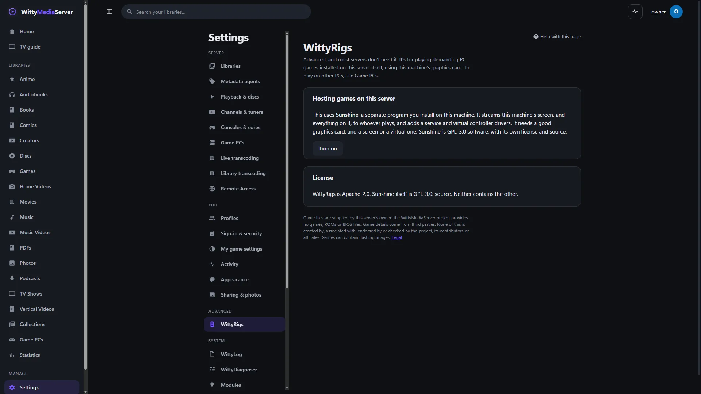
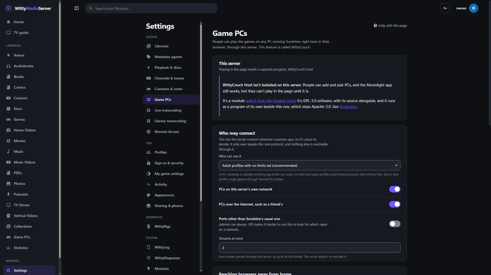

# WittyRigs

An advanced option: host demanding PC games on your server's own hardware. Most servers don't need this. To play on other PCs, a friend's included, use [WittyCouch](https://github.com/wittywilla/WittyCouch).

It isn't part of, or made by, the Sunshine project.

<!-- pictures -->



<sub>Settings, WittyRigs, in WittyMediaServer.</sub>



<sub>Settings, Game PCs, on a server with none added yet.</sub>

<!-- /pictures -->

## What it does

For a server with a good graphics card and PC games installed on it, this finds a separately installed Sunshine on that machine, so its games can become a library. People then play them through WittyCouch, as with any other PC.

It looks in the usual places on Windows and macOS, and on the `PATH` everywhere. It's off until an admin turns it on. Everything that talks to Sunshine is in WittyCouch. No games come with it, and you're responsible for what you host and who you let play it.

How to use it is in **Help** inside WittyMediaServer: see Game PCs.

## How to get it

An admin adds it from the module store inside WittyMediaServer: **Settings → Modules**, then **Browse the store**, then **Add** beside WittyRigs. That needs WittyMediaServer 0.8.0-alpha or later, as this version carries module API 4 (its own server-driven UI, `sdui.json`), and it works with nothing older. The range it fits is in `module.json`: 0.8.0-alpha through 0.8.x.

Adding it brings WittyCouch, which it's built on.

## What it needs

- [WittyCouch](https://github.com/wittywilla/WittyCouch).
- Sunshine, which you install yourself on the server.
- A graphics card and PC games on that machine.

It's built on [WittyModule](https://github.com/wittywilla/WittyModule) and written in Go with no cgo.

## Platforms

A program is built for each system below, and the server uses the right one.

| System | Where it stands |
|---|---|
| Linux (x64, arm64, 32-bit ARM, x86) | It builds and packs, and has no tests of its own. It hasn't hosted a real game. The other CPUs are only built |
| Windows (x64, arm64) | Built. This version hasn't been run on Windows since it became its own program |
| macOS (Intel, Apple silicon) | Built by the release tool. It has not been run on a real Mac |
| FreeBSD (amd64, arm64) | Cross-compiled only. It has not been run |

On macOS and FreeBSD the server has no sandbox for a module's helper: it gets a small environment and a soft memory limit, and nothing more.

## Building and testing

You need Go 1.26 or newer. In a worktree, first run the copy of `dev-modules.mjs` kept above the repositories (`node D:/projects/dev-modules.mjs` on the development machine). It writes a `go.work` that git ignores, so the checkout builds against the repositories beside it. Never run `go work use`.

```bash
go vet ./...
```

```bash
go test ./... -count=1
```

```bash
go run github.com/wittywilla/wittymodule/cmd/wittymodule check .
```

The last one checks the manifest. On the same tool, `pack -targets linux/amd64 -out release .` builds a release for one system. CI also builds for every system.

## Licence

GNU Affero General Public License v3.0 (or later): see [LICENSE](LICENSE) and [NOTICE](NOTICE). If you redistribute it or build on it, please keep the NOTICE attribution. It contains no Sunshine code. Sunshine is GPL-3.0 and stays a separate program, which this only looks for. Each release archive carries a `THIRD-PARTY-NOTICES.txt` for what its programs link.

## Legal

WittyRigs is an independent open-source project. It isn't associated with, sponsored by or endorsed by
the Sunshine or Moonlight projects, or any game publisher. Sunshine is a separate program you install
yourself, under its own license, and no games come with this. You're responsible for what you host and
who you let play it. Any third-party names here only describe what it works with, and belong to their
owners. It's provided “as is”, with no warranty; see [LICENSE](LICENSE). Local law applies to how you use
it. This isn't legal advice.

<!-- module-kit -->
## Releasing

A version tag builds a program for every platform, signs the checksum list, and publishes a release that servers can install.

Versions move in small steps as work lands. `go run github.com/wittywilla/wittymodule/cmd/wittymodule@v0.4.0 bump .` raises it
everywhere it is written (add `-part minor` for a bigger step). A bump isn't a release: nothing is
tagged or published until you tag it. CI fails when code changed since the last tag and the version
didn't, because tags never move.

To release:

1. Check that `version` in `module.json` is the one to publish, with the bump committed.
2. Tag that commit and push the tag: `git tag vX.Y.Z`, then `git push origin vX.Y.Z`. A tag with a
   suffix, such as `v1.2.0-beta`, is published as a prerelease.
3. Watch the *Actions* tab. The signing step uses the `WMS_SIGNING_KEY` secret of the `release` environment, and nothing is published without it.

To take a version back, run the *withdraw* workflow from the *Actions* tab. It adds the version to a signed list on the release tagged `withdrawals`, which servers read.

Licensed under AGPL-3.0-or-later: see [LICENSE](LICENSE) and [NOTICE](NOTICE).
<!-- /module-kit -->
