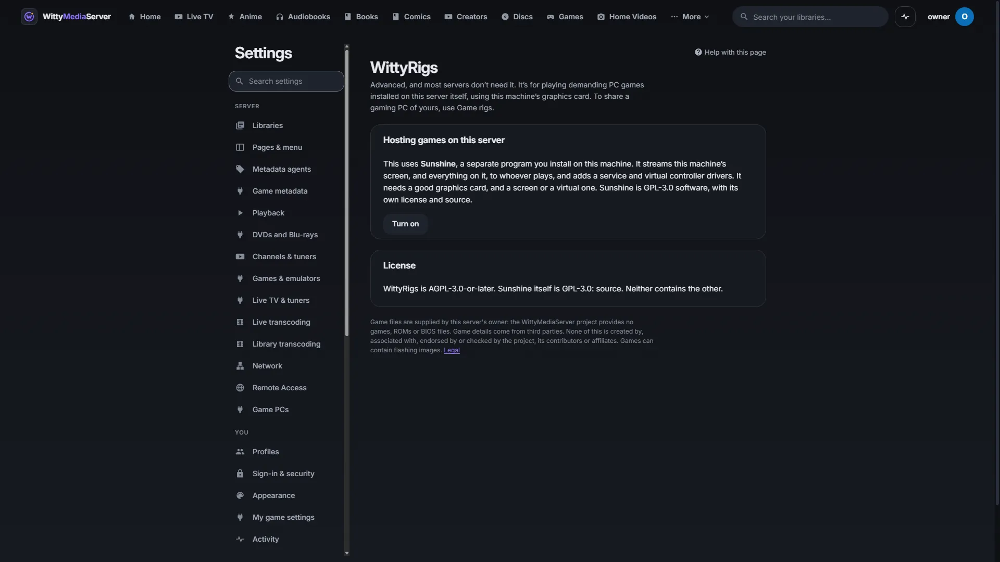
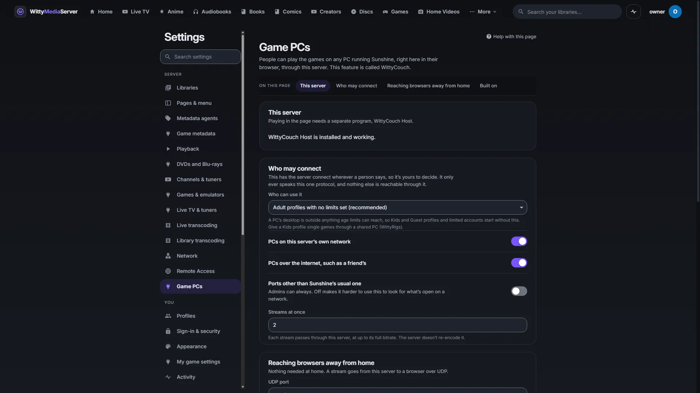

# WittyRigs

Gaming PCs running Sunshine as games libraries of a WittyMediaServer, and the advanced option of hosting demanding PC games on your server's own hardware. To play on a PC of your own that isn't shared with the server's people, a friend's included, use [WittyCouch](https://github.com/wittywilla/WittyCouch).

It's a module of [WittyMediaServer](https://github.com/wittywilla/WittyMediaServer) ([wittymediaserver.com](https://wittymediaserver.com)).

It isn't part of, or made by, the Sunshine project.

<!-- pictures -->



<sub>Settings, WittyRigs, in WittyMediaServer.</sub>



<sub>Settings, Game PCs, on a server with none added yet.</sub>

<!-- /pictures -->

## What it does

- **Game rigs.** An administrator adds a gaming PC running Sunshine (found on the network, or by its address) and pairs it once with a PIN. Its games become a games library on the server, so every access rule applies to them: library limits, age limits, and single games given to a Kids profile. A person plays one in the page, in the Moonlight app, or starts it on the PC to pick up with Resume (an Apple TV, say). It wakes a sleeping PC, ends what's running, and follows a PC to a new address.
- **This server's own Sunshine.** Off until an administrator turns it on: it finds a separately installed Sunshine on the server's machine, in the usual places on Windows, macOS and Linux, and on the `PATH`, and offers its games as a library.

It's a module of [module API 5](https://github.com/wittywilla/WittyMediaServer/blob/master/docs/MODULES-API5.md): it owns the whole feature. Its service answers its own routes at `/api/modules/wittyrigs/...` (`integration.json`), keeps its rigs in a database of its own, and asks the server only for what the server has: the libraries and items that hold each rig's games, who may see them, and the Moonlight host program. Its web part draws its screens in the browser, and its `sdui.json` pages (Game PCs, one PC, this server's Sunshine) are what every app draws, the Apple TV and Android TV apps included, with a remote: nothing on them needs typing.

No games come with it, and you're responsible for what you host and who you let play it. How to use it is in **Help** inside WittyMediaServer: see Game PCs.

## How to get it

An admin adds it from the module store inside WittyMediaServer: **Settings → Modules**, then **Browse the store**, then **Add** beside WittyRigs. This version carries module API 5, so it needs WittyMediaServer 0.8.0-alpha or later and works with nothing older. The range it fits is in `module.json`: 0.8.0-alpha through 0.8.x.

Adding it brings WittyCouch (with WittyCouch Host, the program that plays a PC's games in a page) and WittyPlay, whose games frame its pages sit in. WittyPlay has a known issue with the 0.8.x server, that its emulation isn't working yet: see [its README](https://github.com/wittywilla/WittyPlay#readme).

## What it needs

- [WittyCouch](https://github.com/wittywilla/WittyCouch), whose protocol code it's built on, and WittyCouch Host to play in a page.
- [WittyPlay](https://github.com/wittywilla/WittyPlay).
- Sunshine, which you install yourself on the server.
- A graphics card and PC games on that machine.

It's built on [WittyModule](https://github.com/wittywilla/WittyModule) and written in Go with no cgo.

## Platforms

A program is built for each system below, and the server uses the right one.

| System | Where it stands |
|---|---|
| Linux (x64, arm64, 32-bit ARM, x86) | It builds and packs, and CI runs its tests on x64. It hasn't hosted a real game. The other CPUs are only built |
| Windows (x64, arm64) | Built. This version hasn't been run on Windows since it became its own program |
| macOS (Intel, Apple silicon) | Built by the release tool. It has not been run on a real Mac |
| FreeBSD (amd64, arm64) | Cross-compiled only. It has not been run |

On macOS and FreeBSD the server has no sandbox for a module's helper: it gets a small environment and a soft memory limit, and nothing more.

## Building and testing

You need Go 1.26 or newer. In a worktree, first run the copy of `dev-modules.mjs` kept above the repositories (`node D:/projects/dev-modules.mjs` on the development machine). It writes a `go.work` that git ignores, so the checkout builds against the repositories beside it. Never run `go work use`.

```bash
go vet ./...
```

```bash
go test ./... -count=1
```

```bash
go run github.com/wittywilla/wittymodule/cmd/wittymodule check .
```

The last one checks the manifest. On the same tool, `pack -targets linux/amd64 -out release .` builds a release for one system. CI also builds for every system.

The web part needs Node.js and a WittyModule checkout (`WITTYMODULE`, or `../WittyModule`), and CI doesn't build it:

```bash
npm install
```

```bash
npm run build:bundle
```

**Working on a Mac?** Start with WittyMediaServer's [MAC-START-HERE.md](https://github.com/wittywilla/WittyMediaServer/blob/v0.8.1-alpha/MAC-START-HERE.md): what to install, what to clone, and every Mac task in order: this repository's is item 7.4 (#9).

## Licence

GNU Affero General Public License v3.0 (or later): see [LICENSE](LICENSE) and [NOTICE](NOTICE). If you redistribute it or build on it, please keep the NOTICE attribution. It contains no Sunshine code. Sunshine is GPL-3.0 and stays a separate program, which this only looks for. Each release archive carries a `THIRD-PARTY-NOTICES.txt` for what its programs link.

<!-- module-kit -->
## Releasing

A version tag builds a program for every platform, signs the checksum list, and publishes a release that servers can install.

Versions move in small steps as work lands. `go run github.com/wittywilla/wittymodule/cmd/wittymodule@v0.5.4 bump .` raises it
everywhere it is written (add `-part minor` for a bigger step). A bump isn't a release: nothing is
tagged or published until you tag it. CI fails when code changed since the last tag and the version
didn't, because tags never move.

To release:

1. Check that `version` in `module.json` is the one to publish, with the bump committed.
2. Tag that commit and push the tag: `git tag vX.Y.Z`, then `git push origin vX.Y.Z`. A tag with a
   suffix, such as `v1.2.0-beta`, is published as a prerelease.
3. Watch the *Actions* tab. The signing step uses the `WMS_SIGNING_KEY` secret of the `release` environment, and nothing is published without it.

To take a version back, run the *withdraw* workflow from the *Actions* tab. It adds the version to a signed list on the release tagged `withdrawals`, which servers read.

Licensed under AGPL-3.0-or-later: see [LICENSE](LICENSE) and [NOTICE](NOTICE).
<!-- /module-kit -->

## Legal

WittyRigs is an independent open-source project. It isn't associated with, sponsored by or endorsed by
the Sunshine or Moonlight projects, or any game publisher. Sunshine is a separate program you install
yourself, under its own license, and no games come with this. You're responsible for what you host and
who you let play it. Any third-party names here only describe what it works with, and belong to their
owners. It's provided “as is”, with no warranty; see [LICENSE](LICENSE). Local law applies to how you use
it. This isn't legal advice.
